  

# 🚀 Awesome API Load & Performance Testing 📊

  
  
  
  
  
  

---

> **A curated, comprehensive guide and index to open-source load generators, cloud-native stress testing SaaS platforms, benchmarking tools, and performance engineering resources for REST, GraphQL, gRPC, and WebSocket APIs.**

Whether you are running high-concurrency stress testing, continuous regression benchmarking in CI/CD pipelines, or distributed capacity planning, this list helps developers, QA engineers, and SREs choose the right tool for their workload.

---

## 📑 Table of Contents
- [🌐 Sector Overview & Market Dynamics](#-sector-overview--market-dynamics)
- [💻 Open Source Testing Frameworks](#-open-source-testing-frameworks)
- [☁️ SaaS & Cloud Performance Platforms](#-saas--cloud-performance-platforms)
- [📈 Star History](#-star-history)
- [🤝 Contributing](#-contributing)
- [💖 Support & Sponsorship](#-support--sponsorship)

---

## 🌐 Sector Overview & Market Dynamics

The global load and performance testing market is currently estimated at **$1.4B to $1.65B**, with forecasts projecting growth beyond **$5B to $7.5B** over the next decade. This growth is accelerated by microservices complexity, cloud-native deployments, and the necessity of shift-left performance automation within DevOps pipelines.

The sector is **moderately fragmented** rather than a winner-take-all monopoly: while open-source tools (Apache JMeter, Locust, k6, Vegeta) anchor foundational developer adoption, commercial market share is distributed across legacy enterprise suites (Tricentis, Perforce/BlazeMeter), developer-centric observability ecosystems (Grafana Labs, Postman), and specialized distributed SaaS platforms (Artillery, Gatling, OctoPerf).

---

## 💻 Open Source Testing Frameworks

The table below lists battle-tested, open-source performance testing frameworks and CLI benchmark utilities, **sorted in descending order by GitHub stargazers**. Each star count links directly to that repository's stargazers page.

| Framework | GitHub Stars | License | Scripting Language | Core Strengths & Protocols |
| :--- | :--- | :--- | :--- | :--- |
| **[wrk](https://github.com/wg/wrk)** |  | Apache-2.0 | C (Lua scripts) | ⚡ Extreme throughput, multi-threaded event-driven HTTP benchmarking from a single instance. |
| **[k6](https://github.com/grafana/k6)** |  | AGPL-3.0 | JavaScript / ES6 (Go core) | 🛠️ Modern developer-first CLI, thresholds, scenarios, and native Grafana/Prometheus metric integrations. |
| **[Locust](https://github.com/locustio/locust)** |  | MIT | Python | 🐍 Code-as-tests in pure Python, lightweight coroutines (gevent), web-based real-time control UI. |
| **[Vegeta](https://github.com/tsenart/vegeta)** |  | MIT | Go | 🎯 Constant-rate (open-loop) HTTP load testing CLI and Go library for precise rate attacks. |
| **[hey](https://github.com/rakyll/hey)** |  | Apache-2.0 | Go | 🚀 Modern, fast command-line HTTP load generator; minimal zero-config alternative to ApacheBench (`ab`). |
| **[Apache JMeter](https://github.com/apache/jmeter)** |  | Apache-2.0 | Java / Groovy (GUI) | 🏛️ Industry-standard protocol suite (HTTP/S, SOAP/REST, JDBC, LDAP, JMS, FTP), headless CLI mode, and rich plugin ecosystem. |
| **[Artillery CLI](https://github.com/artilleryio/artillery)** |  | MPL-2.0 | YAML / JavaScript | ☁️ Serverless load generator running across AWS Lambda/Fargate with support for HTTP, WebSocket, and Socket.io. |
| **[Autocannon](https://github.com/mcollina/autocannon)** |  | MIT | Node.js (JavaScript) | 🚅 Blazing-fast HTTP/1.1 benchmarking utility written in Node.js, programmatic API, and CLI runner. |
| **[Gatling](https://github.com/gatling/gatling)** |  | Apache-2.0 | Java / Kotlin / Scala | ☕ High-performance asynchronous non-blocking engine built on Akka & Netty, code DSL, and standalone HTML reports. |
| **[Bombardier](https://github.com/codesenberg/bombardier)** |  | MIT | Go | 🏎️ Fast cross-platform HTTP(S) and HTTP/2 benchmarking tool written in Go with fasthttp and net/http engines. |
| **[Drill](https://github.com/fcsonline/drill)** |  | GPL-3.0 | Rust | 🦀 Lightweight HTTP load-testing CLI inspired by Ansible syntax; uses YAML files to orchestrate complex benchmark flows. |
| **[Taurus](https://github.com/Blazemeter/taurus)** |  | Apache-2.0 | Python | 🎛️ Continuous testing abstraction framework that unifies and automates JMeter, Gatling, Locust, and Selenium via YAML. |

---

## ☁️ SaaS & Cloud Performance Platforms

Managed cloud-native platforms, enterprise APM testing suites, and distributed testing networks **sorted in descending order by parent company scale (valuation / annual revenue)**.

| Platform | Parent / Organization | Company Scale (Valuation / Revenue) | Starting Paid Pricing | Free Tier / Free Trial Limits | Key Capabilities |
| :--- | :--- | :--- | :--- | :--- | :--- |
| **Grafana Cloud k6** | Grafana Labs | **$6.0B valuation** (~$600M ARR) | **$0.15 / VUh** (Pro pay-as-you-go above included monthly quota) | **500 VUh / month** forever free, 14-day metric retention, max 50 concurrency | 📊 Developer-centric JS tests, multi-region distributed load generation, and real-time Grafana dashboards. |
| **Postman Performance Testing** | Postman, Inc. | **$5.6B valuation** (~$313M ARR) | **$0.04 / VUh** for cloud-hosted runs (or $14/user/mo billed annually for Basic Team) | **Free forever** with unlimited local VU execution via Desktop App / CLI; 1 seat on Free plan | 📬 Native execution of Postman collections, real-time latency graphs, CI/CD CLI test runs. |
| **Tricentis NeoLoad** | Tricentis | **$4.5B valuation** (~$500M ARR) | **~$20,000 / year** (Professional tier custom licensing quote) | **14-day free trial** strictly capped at **10 Virtual Users (VUs)** | 🏢 Enterprise-wide continuous performance testing, codeless design, SAP/packaged app validations, and APM tracing. |
| **BlazeMeter** | Perforce Software | **~$1.1B valuation** (~$280M–$750M revenue) | **$99 / month** ($1,188 billed annually for Basic tier, 1,000 VUs) | **10 tests / month**, max 50 VUs, max 20 minutes duration, 1 shared generator | 🌐 Multi-engine cloud runner (JMeter, Selenium, Taurus, Locust), global test geographic locations, mock services. |
| **Artillery Cloud** | Artillery | **~$1M ARR** (Seed / privately held) | **$199 / month** (Team tier, up to 25 distributed cloud workers) | **30 test reports / month**, max 5 distributed workers, 30 min duration, 2 seats | ⚡ Distributed serverless cloud load tests on AWS/Azure, collaborative test runs, deep latency distribution percentiles. |
| **Gatling Enterprise** | GatlingCorp | **Bootstrapped / SMB scale** (Privately held) | **€89 / month** (Basic / Starter tier billed annually, up to 60k VUs) | **14-day free trial** with restricted load generator credits and community support | 📈 Dedicated cloud load injectors, centralized team management, PDF/HTML reports, and CI/CD integrations. |
| **OctoPerf** | OctoPerf | **Boutique commercial** (Privately held) | **$99 / test** on-demand (or subscription plans starting at **$999 / month**) | **Free forever** up to **50 concurrent VUs**, 20 min test duration, 1 parallel test | 🎯 Full cloud web UI wrapper for Apache JMeter scripts, multi-cloud load injection, dynamic correlation engine. |
| **Loader.io** | SendGrid / Twilio (Legacy) | **Micro-SaaS scale** (~$150k ARR) | **$99.95 / month** (Pro tier, up to 100,000 clients, 10 min duration) | **10,000 clients / test**, 1-minute max duration, up to 2 URLs, 1 target host | ⏱️ Straightforward web-based stress testing, simple DNS token verification, and instant endpoint response charts. |

---

## 📈 Star History

---

## 🤝 Contributing

Contributions, feature suggestions, and updates are always welcome!
1. Fork the Project 🍴
2. Create your Feature Branch (`git checkout -b feature/NewTestingTool`)
3. Commit your Changes (`git commit -m 'feat: add NewTestingTool'`)
4. Push to the Branch (`git push origin feature/NewTestingTool`)
5. Open a Pull Request 🚀

For more curated developer collections, explore the **[Awesome-Awesome-Awesome](https://github.com/ishandutta2007/Awesome-Awesome-Awesome)** registry.

---

## 💖 Support & Sponsorship

Thank you for visiting and supporting **Awesome API Load & Performance Testing**! If you found this curated list helpful for your architecture, benchmarking, or QA pipelines, please consider supporting the project:

- ⭐ **Star this repository** to help others discover it!
- 🍴 **Fork and share** it with your engineering team or community.
- ☕ **Buy a coffee or sponsor ongoing maintenance**: Visit the [GitHub Sponsors Dashboard](https://github.com/sponsors/ishandutta2007) to become a patron or backer.

Every bit of encouragement and sponsorship keeps this knowledge base updated with the latest testing tools and industry benchmarks!
